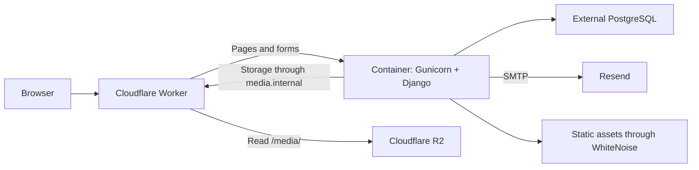

# Architecture

[Project README](../README.md) · [Documentation index](README.md)

System design, module boundaries, data relationships, and the technology stack.

## Architecture and organization

The backend is a modular monolith: Django modules share a process, authentication, configuration, and database, with responsibilities organized by business domain.

### Module responsibilities

| Module | Responsibility |
| --- | --- |
| `app/` | Central configuration, routing, cross-cutting security, encryption, storage, and SEO. |
| `showcase/` | Home page and visual structure of the public storefront. |
| `categories/` | Product classification. |
| `products/` | Products, catalog publication, and stock withdrawal history. |
| `glazing_services/` | Glazing services and their public pages. |
| `accounts/` | Customers, authentication, profiles, email verification, and login attempt protection. |
| `dashboard/` | Management dashboard, quotes, customers, finances, personnel, and suppliers. |
| `calculator/` | Material records and area/length calculators. |
| `sales/` | Sales, line items, commercial calculations, and transactional integration with inventory and cash management. |
| `src/` | TypeScript Worker that forwards requests to Django and integrates media, rate limits, and logging. |
| `scripts/` | Local environment setup and safeguards for publishing the source code. |

### How requests are handled

During development, the browser connects directly to the Django server. `app/urls.py` resolves the URL and forwards the request to a view. The view validates access and forms, queries or updates models, and renders a template or returns a specific response, such as JSON or PDF.

In the production configuration, the Worker receives requests first. It applies the configured limits to sensitive routes, serves media from R2, and forwards other requests to the container. Inside the container, Gunicorn serves Django and WhiteNoise delivers collected static assets.

The `R2WorkerStorage` adapter sends file operations to the restricted virtual host `http://media.internal`. The container's outbound handler in `src/index.ts` performs these operations using the R2 binding. Database credentials and encryption keys are injected through the production environment.

### Core relationships

| Entities | Relationship |
| --- | --- |
| `User` and `Profile` | One customer profile per login account. |
| `Category` and `Product` | One category can contain multiple products. |
| `Profile` and `QuoteRequest` | A customer can submit multiple requests; each request preserves the essential customer details. |
| `QuoteRequest`, `Product`, and `Service` | A quote can reference multiple products and services. |
| `QuoteRequest`, `QuoteStatusHistory`, and `QuoteAdminNotification` | Service history and tracking of notifications delivered to the team. |
| `Sale` and `SaleItem` | A sale contains product, material, or service items. |
| `Sale`, `SaleStockMovement`, and `ProductStockExit` | Traceability of stock deductions and returns. |
| `Sale` and `CashTransaction` | Separate links for payment and refund transactions. |
| `Expense` and `CashTransaction` | An expense keeps its associated cash outflow. |
| `Employee`, `Payroll`, and `CashTransaction` | Employee, payroll records by period, and corresponding cash entries. |
| `Supplier` and `Expense` | An expense may reference a supplier. |

**Service module compatibility:** the package is named `glazing_services`, but its `AppConfig` retains `label='services'`. This label preserves existing tables and migration dependencies; do not change it solely to match the directory name.

## Technology stack

The versions below match the project's dependency files.

| Layer | Technology | Purpose |
| --- | --- | --- |
| Backend | Python 3.11+ and Django 5.2.17 | Views, ORM, forms, authentication, templates, and migrations. |
| Production database | PostgreSQL and psycopg 3.3.4 | Persistence and locking for transactional workflows. |
| Demo database | SQLite | Local setup with a new database. |
| Container server | Gunicorn 26.0.0 | Production WSGI execution. |
| Static assets | WhiteNoise 6.12.0 | Delivery of collected static files. |
| Images | Pillow 13.0.0 | Validation of upload format, content, and dimensions. |
| Encryption | cryptography 50.0.1 | AES-256-GCM for sensitive fields. |
| Interface | Django templates, HTML, CSS, JavaScript, Bootstrap, and Bootstrap Icons | Pages, forms, and local interactions. Some styles and scripts are embedded in templates. |
| Worker | TypeScript 5.9.3 and `@cloudflare/containers` 0.3.7 | Container proxy and R2 integration. |
| Cloudflare tooling | Wrangler 4.125.0 | Worker development, types, validation, and deployment. |
| Packaging | Docker, Docker Compose, and pnpm | Django container, local PostgreSQL, and Worker dependencies. |
| Secret scanning | Gitleaks | Code and history inspection in the security workflow. |

The `Dockerfile` uses Python 3.11 on Alpine; Compose configures PostgreSQL 17. Node.js 24 and pnpm are used for Worker checks. Cloudflare tooling is not required to run only the local Django demo.
